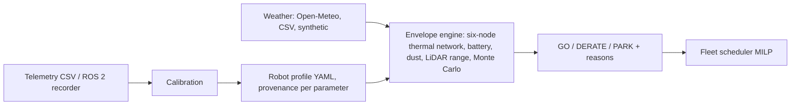

# Dhill (ظل)

**Thermal and dust operating-envelope intelligence for autonomous ground systems in hot-arid environments.**

*Know when your robot should rest in the shade.*

> **Status: v0.5.0, working proof of concept (TRL 3).** The engine, API, dashboard, planner and calibration run and are tested. Bundled robot profiles are **illustrative (evidence level L0)**; nothing here has been validated against field data. See [Honest limits](#honest-limits).

---

## The problem

Autonomous ground systems in the Gulf work in air near 50 °C, in direct sun, and in some of the heaviest airborne dust measured anywhere. Operators decide when to run with blanket rules ("nothing at midday") or the air-temperature rating on a datasheet. Neither accounts for solar heating of the chassis, the heat the robot makes during its own mission, dust on LiDAR windows, filters and heat sinks, or the robot's thermal history before it starts. Robots end up parked unnecessarily, or throttle, shut down and age their batteries early.

## What Dhill does

For a robot profile, a mission, a place and a time, Dhill returns a decision with reasons:

| Decision | Meaning |
|---|---|
| **GO** | Every component stays inside its limit less a margin, for the whole mission, at a 95% risk quantile |
| **DERATE** | Run at a reduced speed/power scale; Dhill finds the largest safe scale and names the binding constraint |
| **PARK** | Not safe even at the minimum scale; Dhill reports the shade fraction that would help and the next feasible window |

Non-GO decisions also report the **probability of exceeding a hard limit** and the **time to limit** at full scale. Every decision carries the profile's **evidence level** (L0 uncalibrated, L1 datasheet-parameterised, L2 field-calibrated, L3 independently validated) and the share of parameters that are assumptions.

Also included: a multi-day **timeline**, a **fleet scheduler** (mixed-integer programme with rest gaps, concurrency limits and a battery-ageing penalty), a **sensitivity analysis** that ranks which unknown parameter to measure first ([`docs/sensitivity.md`](docs/sensitivity.md)), a **policy comparison** against simple operator rules on a hidden robot ([`docs/policy-comparison.md`](docs/policy-comparison.md)), **calibration** from telemetry with confidence intervals and an identifiability flag, an offline **dashboard**, a **REST API**, and a **ROS 2 telemetry recorder**.

## Quick start

```bash
pip install -e ".[dev]"
dhill list sites
dhill decide  --site sweihan --scenario heatwave --at 2026-08-05T09:00
dhill timeline --site sweihan --scenario heatwave --step-min 120
dhill sensitivity --profile ugv_medium_inspection --site sweihan --scenario heatwave --at 2026-08-05T09:00
dhill plan --robots ugv_medium_inspection sidewalk_delivery_robot
dhill serve            # dashboard at http://127.0.0.1:8080
# live forecast and PM10 (Open-Meteo, falls back to synthetic with a warning)
dhill timeline --site abu_dhabi --source live
```
or `docker compose up`.

## What it produces (synthetic weather, illustrative robot)

```
ugv_medium_inspection @ sweihan  (synthetic, L0)  1 h missions
08-05T00:00  GO     1.00 ####################
08-05T04:00  DERATE 0.57 ############
08-05T06:00  PARK   0.00
08-05T14:00  PARK   0.00
08-05T16:00  DERATE 0.78 ################
08-05T18:00  GO     1.00 ####################
```

Versus a fixed 08:00 to 17:00 full-speed shift, the scheduler completes the same 12 work-hours with no predicted limit breach, while the fixed shift would breach a limit in 22 of 24 blocks. That count is **relative to Dhill's own L0 model**: it shows what the method does, and is exactly what a field trial must test.

A second result is worth stating plainly (`examples/value_of_calibration.py`): a nominal model that ignores parameter uncertainty is unsafe in 8 slots against a hidden "true" robot that runs hotter than assumed, while the uncertainty-aware envelope is not. Calibration cut hold-out temperature error from 1.2 K to 0.4 K. Details and caveats in [`docs/results.md`](docs/results.md).


*Dashboard, illustrative L0 robot, synthetic heatwave at Sweihan.* A real live-forecast run is in [`examples/`](examples/) (Abu Dhabi, 10 October 2026: GO overnight, PARK 07:00 to 11:00 UTC, GO again from 14:00 UTC).

## How it works



A batched backward-Euler solver integrates every start time, scale, shade level and Monte Carlo sample at once; a 72-hour hourly timeline with 64 samples takes about a second on a laptop. Parameter spreads follow their provenance (measured 2% to assumption 25%). See [`docs/architecture.md`](docs/architecture.md), [`docs/model-card.md`](docs/model-card.md) and [`docs/parameters.md`](docs/parameters.md).

## Why the UAE, why now

Abu Dhabi's Smart and Autonomous Systems Council has directed a move from pilots to practical deployment of autonomous systems; heat and dust are where pilots end and deployment begins. Mapping to UAE and Abu Dhabi strategies, with the items still to verify, is in [`docs/uae-alignment.md`](docs/uae-alignment.md). The path to industry adoption, without implying any endorsement, is in [`docs/edge-integration.md`](docs/edge-integration.md).

## Honest limits

- **L0 profiles.** At least 80% of bundled parameters are assumptions. Treat outputs as method demonstrations, not operating authorisations.
- **No field validation yet.** The validation protocol ([`docs/validation-protocol.md`](docs/validation-protocol.md)) defines the bench and field steps needed for L2 and L3.
- **Calibration tests are synthetic** and share a model with the data generator.
- **The policy comparison is synthetic**: the engine and the hidden robot share a model structure. A conservative rule (air ≤ 40 °C) was competitive in some cases. See [`docs/policy-comparison.md`](docs/policy-comparison.md) and [`docs/requirements-traceability.md`](docs/requirements-traceability.md).
- **ROS 2 node** has not been run on a live ROS graph (ROS package servers were unreachable from the build environment); its logic is unit tested.
- **No compliance claims** against MIL-STD-810H, IEC 60529, ISO 13482 or similar.
- **Not the EDGE ATP 2026 ChallengeOn track**, which concerns connectivity.
- **Novelty is unchecked**: the search protocol is in [`docs/literature-search-protocol.md`](docs/literature-search-protocol.md) but has not been run.
- **Next real step:** one instrumented robot run, using [`docs/field-test-kit.md`](docs/field-test-kit.md) and a pre-registered prediction.

## Repository map

`src/dhill/physics` models · `profiles` robot profiles · `weather` providers · `envelope.py` decisions · `planner.py` scheduling · `calibrate.py` fitting · `api` + `web` service · `ros2` recorder · `docs` documentation · `examples` studies · `tests` about 90 tests.

## Development

`make install test lint`. CI runs ruff, pytest on Python 3.11 to 3.13, pip-audit and a CycloneDX SBOM. Release history in [`CHANGELOG.md`](CHANGELOG.md); the plan is in [`plan.md`](plan.md).

## Licence

No licence selected yet (all rights reserved by default); see [`docs/adr/0002-licensing.md`](docs/adr/0002-licensing.md).
