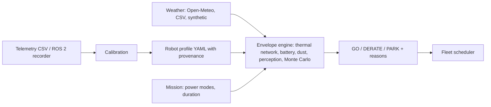

# Dhill (ظل)

**Thermal and dust operating-envelope intelligence for autonomous ground systems in hot-arid environments.**

*Know when your robot should rest in the shade.*

> **Status: pre-alpha (`v0.0.1`, planning release).** The architecture, requirements and validation plan are in [`plan.md`](plan.md). Working code lands in the tagged releases listed under [Roadmap](#roadmap). Nothing here is validated against field data yet.

---

## The problem

Autonomous ground systems in the Gulf work in air above 50 °C, under direct sun, and in some of the heaviest airborne dust measured anywhere. Operators decide when to run with blanket rules ("nothing at midday") or with the air-temperature rating on a datasheet. Neither accounts for:

- solar heating of the chassis, which can push internal temperatures well above ambient,
- the heat the robot generates itself during the planned mission,
- dust on LiDAR windows, filters and heat-sinks,
- the thermal history of the robot before it starts.

The result is robots that are parked unnecessarily or that throttle, shut down or age their batteries early in the field.

## What Dhill does

For a robot profile, a mission, a place and a time, Dhill returns an operating decision with reasons:

| Decision | Meaning |
|---|---|
| **GO** | Every component stays inside limits for the whole mission, with the stated confidence |
| **DERATE** | Run at a reduced power/speed scale (Dhill computes the largest safe scale) |
| **PARK** | Do not run; Dhill reports the shade fraction that would make operation feasible |

Each decision includes the limiting component, margin to limit, time-to-limit, probability of exceedance, battery ageing cost, a dust-limited maximum speed, and an **evidence level** (L0 uncalibrated, L1 datasheet-parameterised, L2 field-calibrated, L3 independently validated). Dhill never presents an uncalibrated decision as validated.

On top of the decision engine:

- **Window timeline**: 72-hour GO/DERATE/PARK bands for a mission at any UAE location.
- **Fleet scheduler**: assigns missions to robots and start times (mixed-integer programme) with cooldown and ageing penalty.
- **Calibration**: fits thermal parameters from telemetry, with uncertainty and identifiability warnings.
- **ROS 2 recorder**: logs robot temperatures, speed and power in the Dhill schema.
- **Ops console and REST API**: runs offline, self-hosted, no cloud dependency.

## How it works

The thermal model is a six-node lumped network (shell, interior, battery, compute, LiDAR, motors) driven by solar load, wind, sky and ground radiation, mission power and dust. See [`plan.md`](plan.md) section 7 for the equations and assumptions.

## Why the UAE, why now

Abu Dhabi's Smart and Autonomous Systems Council has directed a move from pilots to practical deployment of autonomous systems. Heat and dust are where pilots end and deployment begins. The mapping to UAE and Abu Dhabi strategies (AI Strategy 2031, Net Zero 2050, Operation 300bn, SAVI) is in [`plan.md`](plan.md) section 3.

## Roadmap

| Tag | Content |
|---|---|
| `v0.0.1` | Plan, README, scaffold (this release) |
| `v0.1.0` | Physics core and unit tests |
| `v0.2.0` | Envelope engine, weather providers, scheduler, calibration, CLI |
| `v0.3.0` | REST API, offline ops console, ROS 2 recorder, Docker, CI |
| `v0.4.0` | Documentation set: UAE alignment, EDGE integration, model card, validation protocol, threat model |
| `v0.5.0` | First field-calibrated profile (needs an instrumented robot) |
| `v1.0.0` | Independent validation and pilot |

## Honest limits

- Dhill is a **decision-support and research tool**. It is aligned to, not compliant with, standards such as MIL-STD-810H and IEC 60529, and it is not a substitute for accredited environmental testing.
- Default robot parameters are textbook values, datasheet values or explicit assumptions. Each is tagged with its provenance.
- Weather and dust inputs come from forecast models with coarse grids; local dust fronts can be missed.
- Current maturity is TRL 3. Moving higher needs field data (see the validation plan).

## License

No licence has been selected yet; all rights reserved pending a decision (see `plan.md` section 15).

## Author

Huda Mueen. Built for research and industry adoption in the UAE.
