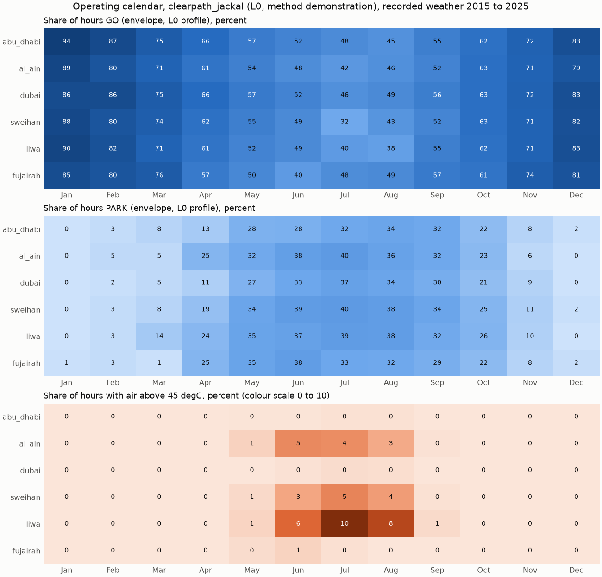

# Operating calendar: clearpath_jackal at six UAE sites

Generated by `scripts/gen_operating_calendar.py`. Every number in this document is computed by
that script from `examples/operating_calendar_clearpath_jackal.csv` (month table) and `examples/operating_calendar_clearpath_jackal_hours.csv`
(every hourly decision). A test (`tests/test_climatology.py`) checks that the headline below
equals the code's result on the CSV.

**Evidence level: L0.** The profile is anchored to the manufacturer
datasheet but 83 % of its parameters are assumptions
(`docs/robot-sources.md`). The result is a method demonstration on recorded weather. It is not a
statement about how a real Jackal behaves, and it is not an operating authorisation.

## Headline

Across 6 sites and 2015 to 2025, with months weighted by their
length, the envelope for the L0 Jackal profile returns, for a 1 h drive mission started at a
given hour: **GO 63.9 %**, **DERATE 16.5 %**, **PARK 19.6 %** of hours.
The air temperature alone exceeds the manufacturer's rated 45 degC in **0.8 %** of all recorded hours.
In 35.3 % of hours the air stays within the rating for the whole
mission and the envelope still does not return GO.



## Share of hours GO, percent

| Site | Jan | Feb | Mar | Apr | May | Jun | Jul | Aug | Sep | Oct | Nov | Dec |
|---|---:|---:|---:|---:|---:|---:|---:|---:|---:|---:|---:|---:|
| abu_dhabi | 94 | 87 | 75 | 66 | 57 | 52 | 48 | 45 | 55 | 62 | 72 | 83 |
| al_ain | 89 | 80 | 71 | 61 | 54 | 48 | 42 | 46 | 52 | 63 | 71 | 79 |
| dubai | 86 | 86 | 75 | 66 | 57 | 52 | 46 | 49 | 56 | 63 | 72 | 83 |
| sweihan | 88 | 80 | 74 | 62 | 55 | 49 | 32 | 43 | 52 | 63 | 71 | 82 |
| liwa | 90 | 82 | 71 | 61 | 52 | 49 | 40 | 38 | 55 | 62 | 71 | 83 |
| fujairah | 85 | 80 | 76 | 57 | 50 | 40 | 48 | 49 | 57 | 61 | 74 | 81 |

## Share of hours DERATE, percent

| Site | Jan | Feb | Mar | Apr | May | Jun | Jul | Aug | Sep | Oct | Nov | Dec |
|---|---:|---:|---:|---:|---:|---:|---:|---:|---:|---:|---:|---:|
| abu_dhabi | 6 | 10 | 18 | 21 | 16 | 19 | 19 | 21 | 12 | 16 | 20 | 15 |
| al_ain | 11 | 15 | 24 | 14 | 14 | 15 | 18 | 18 | 15 | 13 | 23 | 21 |
| dubai | 14 | 12 | 20 | 23 | 16 | 14 | 18 | 17 | 14 | 16 | 19 | 17 |
| sweihan | 12 | 17 | 18 | 18 | 11 | 12 | 28 | 18 | 14 | 12 | 18 | 16 |
| liwa | 10 | 15 | 15 | 15 | 12 | 14 | 21 | 24 | 13 | 12 | 19 | 17 |
| fujairah | 14 | 17 | 23 | 18 | 15 | 22 | 19 | 18 | 13 | 17 | 18 | 17 |

## Share of hours PARK, percent

| Site | Jan | Feb | Mar | Apr | May | Jun | Jul | Aug | Sep | Oct | Nov | Dec |
|---|---:|---:|---:|---:|---:|---:|---:|---:|---:|---:|---:|---:|
| abu_dhabi | 0 | 3 | 8 | 13 | 28 | 28 | 32 | 34 | 32 | 22 | 8 | 2 |
| al_ain | 0 | 5 | 5 | 25 | 32 | 38 | 40 | 36 | 32 | 23 | 6 | 0 |
| dubai | 0 | 2 | 5 | 11 | 27 | 33 | 37 | 34 | 30 | 21 | 9 | 0 |
| sweihan | 0 | 3 | 8 | 19 | 34 | 39 | 40 | 38 | 34 | 25 | 11 | 2 |
| liwa | 0 | 3 | 14 | 24 | 35 | 37 | 39 | 38 | 32 | 26 | 10 | 0 |
| fujairah | 1 | 3 | 1 | 25 | 35 | 38 | 33 | 32 | 29 | 22 | 8 | 2 |

## Share of recorded hours with air above 45 degC, percent

Counted over every hour of the record, not only the sampled days.

| Site | Jan | Feb | Mar | Apr | May | Jun | Jul | Aug | Sep | Oct | Nov | Dec |
|---|---:|---:|---:|---:|---:|---:|---:|---:|---:|---:|---:|---:|
| abu_dhabi | 0 | 0 | 0 | 0 | 0 | 0 | 0 | 0 | 0 | 0 | 0 | 0 |
| al_ain | 0 | 0 | 0 | 0 | 1 | 5 | 4 | 3 | 0 | 0 | 0 | 0 |
| dubai | 0 | 0 | 0 | 0 | 0 | 0 | 0 | 0 | 0 | 0 | 0 | 0 |
| sweihan | 0 | 0 | 0 | 0 | 1 | 3 | 5 | 4 | 0 | 0 | 0 | 0 |
| liwa | 0 | 0 | 0 | 0 | 1 | 6 | 10 | 8 | 1 | 0 | 0 | 0 |
| fujairah | 0 | 0 | 0 | 0 | 0 | 1 | 0 | 0 | 0 | 0 | 0 | 0 |

## Before and after the profile fix

Commit 6f38479 on branch `fix/jackal-rated-ambient` raised three assumed conductances (shell to interior 4.4 to
12.0 W/K, battery 1.2 to 2.0 W/K, compute 2.0 to 4.5 W/K) so that the profile stays inside its
limits at the rated ambient in shade. Before: `examples/before-fix/` (same weather, days, seeds).

| Share of hours | Before the fix | After the fix |
|---|---:|---:|
| GO | 6.0 % | 63.9 % |
| DERATE | 69.6 % | 16.5 % |
| PARK | 24.4 % | 19.6 % |
| Air above the rated ambient (all recorded hours) | 0.8 % | 0.8 % |
| Not GO although mission air stays within the rating | 93.2 % | 35.3 % |

## Candid reading

1. **The calendar is as sensitive as this to three unmeasured numbers.** The change above comes
   only from the three conductances, which were chosen to match the datasheet rating, not
   measured (`docs/robot-sources.md` gives a plausibility check: all three sit at the upper end of
   what free convection and radiation can give). The absolute shares remain properties of the
   assumptions until those conductances are measured.
2. **An ambient rating does not cover a robot in sun.** Air above 45 degC is rare
   in this record (0.8 % of hours; at most 9.8 % at liwa in Jul),
   yet the envelope withholds GO in 36.1 % of hours. With the fixed profile GO is
   the majority decision only when the mission air stays at or below 35 degC, and GO never
   occurs above 40 degC. The profile is consistent with the rating in shade by
   construction; the remaining gap comes from solar load and from the 1.5 h parked soak in sun
   that precedes each mission in this method. A shaded or cooled shelter between missions would
   change the result and is not modelled here.
3. **The binding component is `battery`** in 90 % of hours that are not GO
   (tightest component at full scale). Its limit (60 degC hard, 5 K margin, source assumption) is an assumption in the
   profile; the cell datasheet value is the next number to obtain.
4. **What the calendar does show.** The method runs end to end on eleven years of recorded
   weather and separates hours that need derating from hours that need parking per site and
   month. The GO share is 89 % in January and 43 % in July on average across
   sites; the best month is Jan at abu_dhabi (94 %). Missions starting 00:00 to 05:00 local are GO in
   100 % of sampled night hours.
5. **Next step.** Measure shell to interior, battery and compute conductances and the battery
   limit on a real unit (`docs/field-test-kit.md`), update the profile, rerun this script.

### GO share by mission air temperature (weighted sampled hours, all sites)

| Mission air max (degC) | Hours | GO | DERATE | PARK | Median headroom at full scale (K) |
|---|---:|---:|---:|---:|---:|
| up to 15 | 232 | 100 % | 0 % | 0 % | +21.8 |
| 15 to 20 | 901 | 100 % | 0 % | 0 % | +17.4 |
| 20 to 25 | 1639 | 93 % | 7 % | 0 % | +12.3 |
| 25 to 30 | 1813 | 76 % | 23 % | 1 % | +6.9 |
| 30 to 35 | 2052 | 63 % | 23 % | 14 % | +2.3 |
| 35 to 40 | 1282 | 15 % | 29 % | 56 % | -9.5 |
| 40 to 45 | 651 | 0 % | 10 % | 90 % | -16.4 |
| above 45 | 70 | 0 % | 0 % | 100 % | -20.4 |

## Method

- **Weather.** Open-Meteo historical archive (reanalysis) and air quality API (CAMS), hourly, UTC, 2015 to 2025,
  one request per site and year, cached on disk. Sites and coordinates are those in
  `src/dhill/sites.py`. The archive is a gridded reanalysis, not a station record.
- **Representative days.** For each site and calendar month, every complete local day (UTC+4)
  in the record is ranked by its daily maximum air temperature. The days at the 10th, 30th, 50th,
  70th and 90th percentile (nearest rank) each stand for a 20 % band and carry equal weight
  in the hour shares. The hottest and the mildest day are also run and reported as bounds
  (columns `hottest_day_share_go` and `mildest_day_share_go` in the CSV); they carry no weight.
- **Missions.** For each representative day, 24 missions of 1 h in drive mode, one starting at
  every local hour, through the existing `Envelope` with its defaults (95 % risk quantile,
  64 Monte Carlo samples, seed 7, 1.5 h parked soak in sun before
  each start). GO, DERATE and PARK follow the engine's rule: largest safe scale 1, between the
  minimum scale and 1, or none.
- **Rated ambient.** 45 degC from docs/robot-sources.md (Clearpath Jackal datasheet, Sept 2020). The
  share of hours above it is counted over the full record.
- **PM10.** CAMS through the Open-Meteo air quality API returns values only from August 2022
  (first value per site: abu_dhabi 2022-08-04, al_ain 2022-08-04, dubai 2022-08-04, sweihan 2022-08-04, liwa 2022-08-04, fujairah 2022-08-04). For hours before that, PM10 is the median CAMS value
  for the same site, month and local hour over the available years, flagged
  `pm10_source = cams_hourly_median` in the hourly CSV. On average 71 % of weighted sampled days use the fill.

## Limits

- L0 profile: the thermal parameters are assumptions; the shares above would change, possibly
  a lot, once the compute heat path, conductances and absorptance are measured.
- Five sampled days per month estimate the hour shares; they are not a full hourly
  simulation of every day. Days with similar daily maximum can differ in humidity, wind and cloud.
- Reanalysis temperature at a grid cell differs from the air next to a robot, especially in
  urban heat and near the coast. The archive irradiance is an hourly mean used as an
  instantaneous value, as elsewhere in the engine.
- PM10 before August 2022 is a climatological fill, not the recorded value for that hour.
- The robot is assumed to start each mission after a 1.5 h parked soak in full sun. A robot
  kept in shade or a cooled shelter between missions would do better.
- No standard is claimed or implied.

## Data gaps

- None: every requested site and year was retrieved.

## Reproduce

```bash
pip install -e ".[dev,plot]"
python scripts/gen_operating_calendar.py
dhill calendar --profile clearpath_jackal --offline   # same table, from the cache
```
