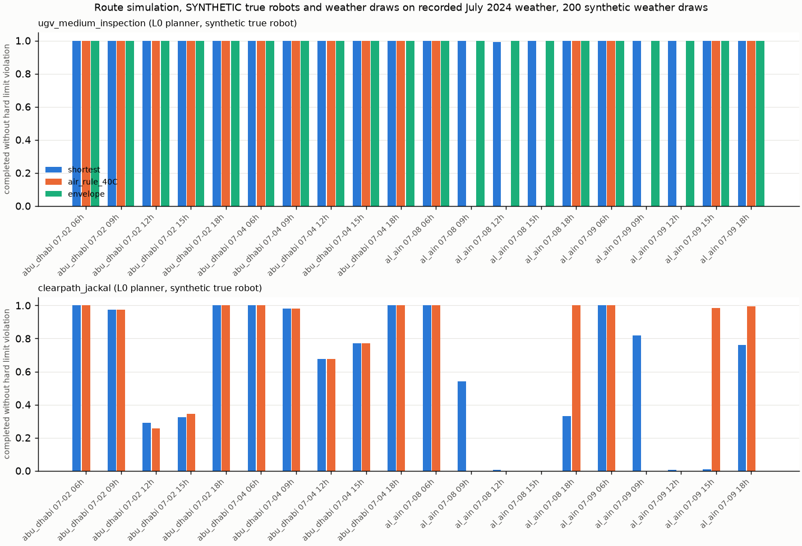

# Route simulation: does the envelope change the plan?

Run: `python examples/route_demo.py --plot`. Raw output: `examples/route_demo_output.txt`. Figure:
`docs/img/route-simulation.png`. Code: `src/dhill/route.py`, tests: `tests/test_route.py`.

**What this is.** A kinematic and thermal simulation in Python: a robot moves along graph segments at a
fixed speed and the existing six node thermal network (`physics/thermal.py`) is integrated along the way,
with the solver's existing shade input for shaded segments and waypoints. It is not Gazebo, not a
dynamics or terrain simulator, and not a physical test. There is no new physics.

**What is real and what is synthetic.**

| Item | Status |
|---|---|
| Weather | Recorded: Open-Meteo archive and CAMS PM10 for Abu Dhabi (2 and 4 July 2024) and Al Ain (8 and 9 July 2024, the two hottest days of 2024 there in the archive, daily maximum 49.0 and 47.7 degC). Files in `tests/data/climatology`. |
| Weather draws for scoring | SYNTHETIC: 200 perturbations per request, air temperature sigma 2 K, irradiance 15 %, wind 30 %, heavier than the engine assumes. |
| Planner robots | L0 profiles `ugv_medium_inspection` and `clearpath_jackal`. |
| True robots | SYNTHETIC: hotter than the profiles (absorptance up by a factor 1.3, shell to interior conductance down by a factor 0.78; the medium UGV also gets the shell heat capacity of `docs/policy-comparison.md`). |
| Route | Assumed: a 3.0 km perimeter patrol depot, north, east, depot in full sun, and an alternative through a partly shaded corridor (shade 0.6) with a shade canopy (0.85) midway. The depot is a covered shelter (0.9). Lengths and shade fractions are illustrative, not a survey. |

## Policies

| Policy | Rule |
|---|---|
| shortest | Shortest path, full scale, leave now. No thermal awareness. |
| air_rule_40C | Shortest path, full scale; wait in the depot shelter until the forecast air temperature over the whole expected mission is at or below 40 degC. |
| envelope | Search start delays (30 min steps), up to two paths per leg, scale 1.0 or 0.7, and an optional 20 min wait at the shaded canopy. Accept a plan only if the 95 % risk quantile peak of every component stays below its limit less margin under the engine's own parameter and forecast uncertainty (48 Monte Carlo samples). Leave at the earliest delay with an accepted plan; take the shortest accepted plan at that delay. |

Each request has a deadline of 360 min. A request is completed in a weather draw if the plan finishes
within the deadline and no component of the true robot exceeds its hard limit. Requests at 06, 09, 12, 15
and 18 local time on each day; seed 123.

## Result (from `examples/route_demo_output.txt`)

| Profile | Site | Policy | Planned | Mean finish (min) | Completion | Mean P(violation) | Risky requests |
|---|---|---|---:|---:|---:|---:|---:|
| ugv_medium_inspection | abu_dhabi | shortest | 10/10 | 34.0 | 100.0 % | 0.0 % | 0 |
| | | air_rule_40C | 10/10 | 58.0 | 100.0 % | 0.0 % | 0 |
| | | envelope | 10/10 | 34.2 | 100.0 % | 0.0 % | 0 |
| ugv_medium_inspection | al_ain | shortest | 10/10 | 34.0 | 99.9 % | 0.1 % | 0 |
| | | air_rule_40C | 5/10 | 130.0 | 50.0 % | 0.0 % | 0 |
| | | envelope | 10/10 | 108.0 | 100.0 % | 0.0 % | 0 |
| clearpath_jackal | abu_dhabi | shortest | 10/10 | 50.0 | 80.2 % | 19.8 % | 4 |
| | | air_rule_40C | 10/10 | 74.0 | 80.0 % | 20.0 % | 4 |
| | | envelope | **0/10** | n/a | **0.0 %** | n/a | 0 |
| clearpath_jackal | al_ain | shortest | 10/10 | 50.0 | 44.7 % | 55.3 % | 8 |
| | | air_rule_40C | 5/10 | 146.0 | 49.8 % | 0.4 % | 0 |
| | | envelope | **0/10** | n/a | **0.0 %** | n/a | 0 |

Mean finish is over planned requests only. A risky request has P(violation) above 5 %.

## Reading, including where the envelope loses

1. **The envelope does change the plan, not only the yes or no.** On the hottest Al Ain requests the
   medium UGV's envelope plan takes the shaded corridor, waits 20 min under the canopy and delays the
   start (for example 270 min at 12:00 on 8 July), instead of refusing. The air rule simply declines
   five of ten requests there.
2. **Where it loses, case 1: time for almost nothing.** For the medium UGV the true robot was safe on the
   shortest path at full speed in every request (worst P(violation) 1.0 %). The envelope's caution cost a
   mean finish of 108 min against 34 min in Al Ain. Its plans were safe, but the shortest path was also
   safe; the envelope bought at most about 1 % of violation probability with more than an hour of delay.
3. **Where it loses, case 2: it refuses everything for the Jackal.** The L0 Jackal profile cannot pass its
   own 95 % check in July at these sites (the same compute die problem shown in
   `docs/operating-calendar.md`), so the envelope plans nothing and completes 0 % of requests. The
   shortest path completes 80.2 % (Abu Dhabi) and 44.7 % (Al Ain), with real violations at midday. The
   envelope avoids every violation only by never moving, which is not a useful answer.
4. **The air rule is not safe by construction either.** For the Jackal in Abu Dhabi it waited and still
   violated limits in 20.0 % of draws, because 40 degC air is not a good proxy for the compute die.
5. **The weak link is the profile, again.** Both losses come from L0 parameters that are not measured.
   With a measured profile the same planner would be expected to accept more of the safe plans; that is a
   prediction to test, not a result.

## Limits

- Same author built the planner, the true robots and the scorer; they share the model structure. The
  result shows the method's behaviour, not field performance.
- Speed is constant per segment; no acceleration, slope, wheel slip or terrain heat. Shade fractions are
  assumed and constant in time, whereas real shade moves with the sun.
- The envelope search is coarse (two paths per leg, two scales, one wait length, 30 min delay steps) and
  greedy (earliest accepted start). A finer search could find faster safe plans.
- Recorded weather is a gridded reanalysis at the site coordinates, not the microclimate on the route.
